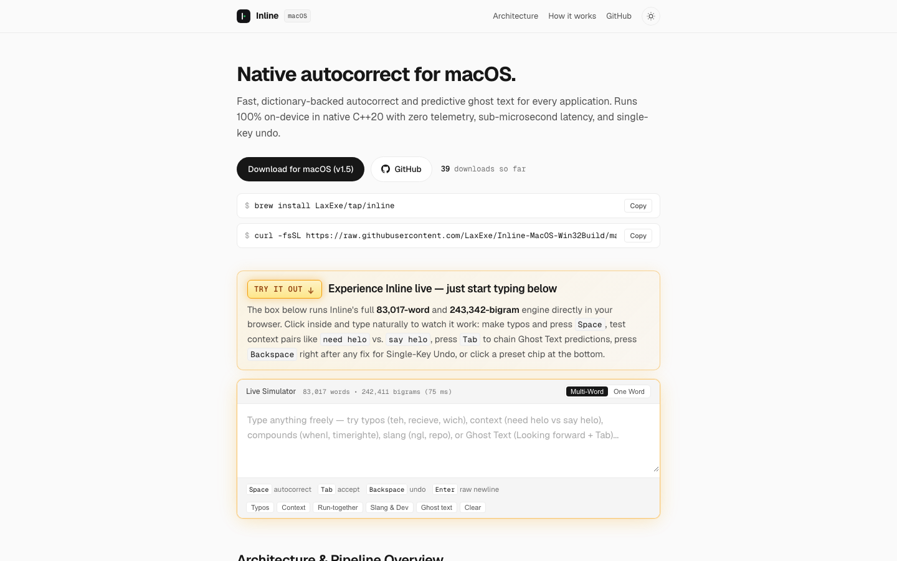
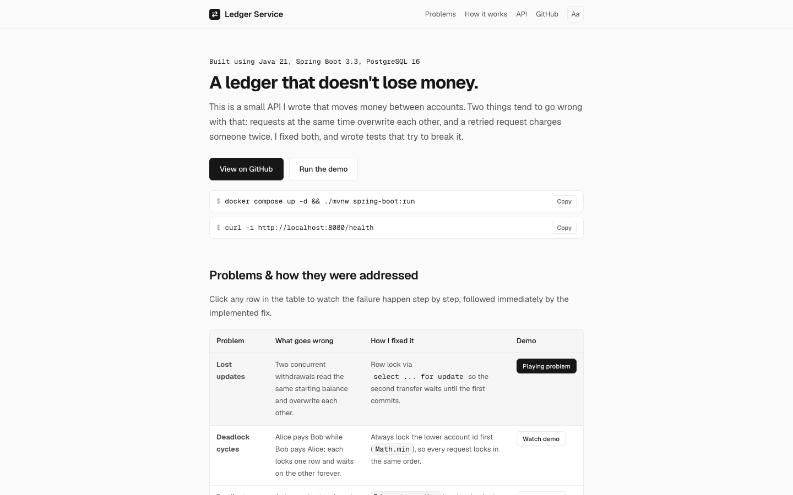
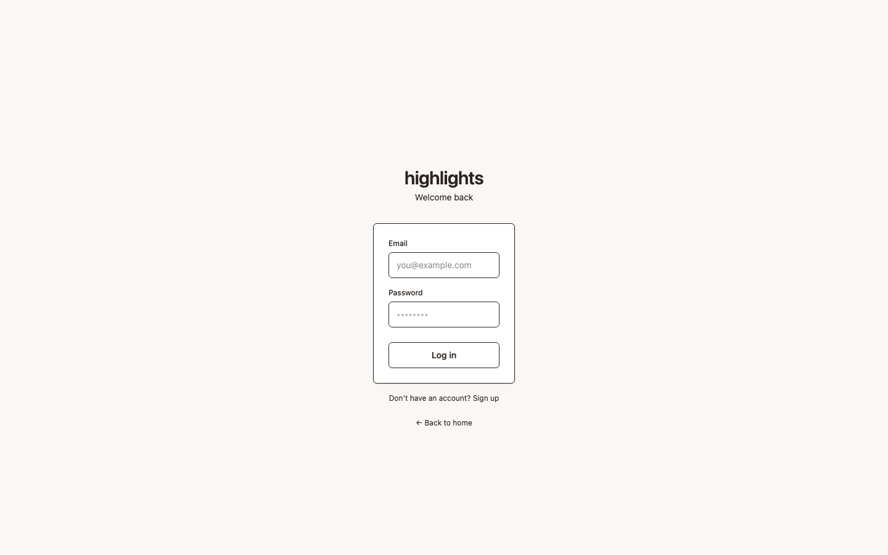
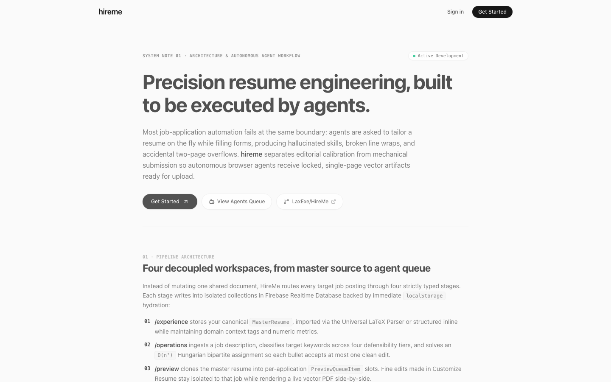
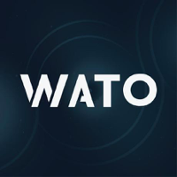
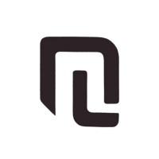
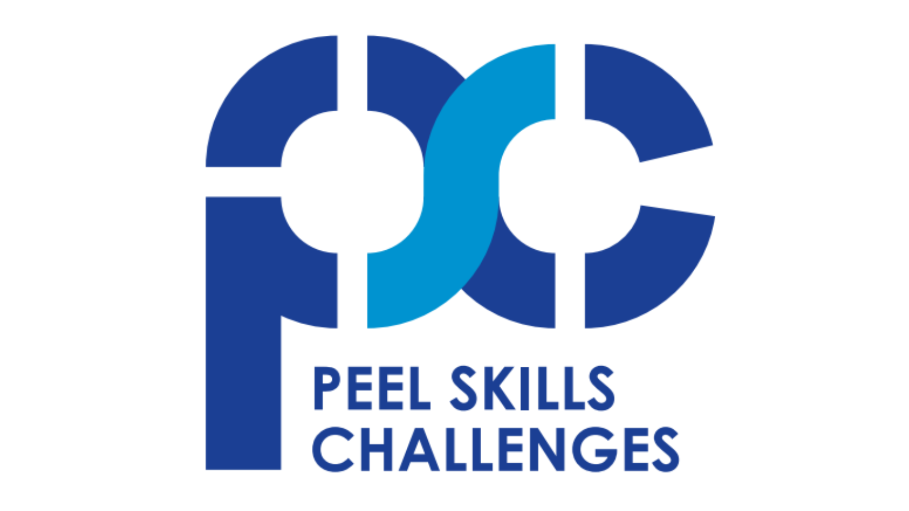
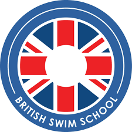
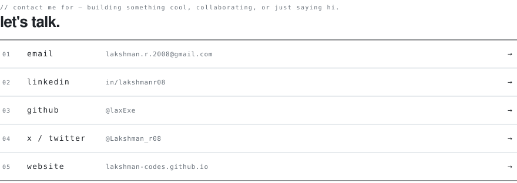

<div align="center">


<a href="https://lakshman-codes.github.io">
  
</a>

[](https://lakshman-codes.github.io)
[](https://linkedin.com/in/lakshmanr08/)
[](https://x.com/Lakshman_r08)
[](mailto:lakshman.r.2008@gmail.com)

</div>

---

## About Me

I'm a **first-year Computer Engineering student at the University of Waterloo** from Ontario, Canada, looking to **build more experience** by shipping real things with real teams. I like building things that work, and I'm into hardware, software, optimization and everything in between.

More of my work, writing and resume: **[lakshman-codes.github.io](https://lakshman-codes.github.io)**

```java
public class Lakshman {
    String school  = "University of Waterloo";
    String program = "Computer Engineering (1st year)";
    String[] loves = { "on-device AI", "backend systems", "autonomy", "shipping" };
    boolean openToBuild = true;   // <- that's the one that matters

    public void say() {
        System.out.println("If you're looking to build, let me know.");
    }
}
```

<p align="center">
  <a href="https://lakshman-codes.github.io/#about">
    
  </a>
</p>

---

## Featured Projects

<table>
<tr>
<td width="50%" valign="top">

<a href="https://laxexe.github.io/Inline-MacOS-Win32Build/"></a>

**Inline**<br>
Autocorrect and word prediction that works across every app on your computer. Runs locally on your machine so nothing you type is ever sent anywhere.<br>
<sub>C++20 · macOS · Rust</sub><br>
[Repo](https://github.com/LaxExe/Inline-MacOS-Win32Build) · [Live demo](https://laxexe.github.io/Inline-MacOS-Win32Build/)

</td>
<td width="50%" valign="top">

<a href="https://laxexe.github.io/ledger-service/"></a>

**Ledger Service**<br>
A backend API that moves money between accounts without losing track of balances, even if two transfers happen at the exact same time or a request gets sent twice.<br>
<sub>Java 21 · Spring Boot 3.3 · PostgreSQL 16</sub><br>
[Repo](https://github.com/LaxExe/ledger-service) · [Walkthrough](https://laxexe.github.io/ledger-service/)

</td>
</tr>
<tr>
<td width="50%" valign="top">

<a href="https://highlights-kappa.vercel.app/home"></a>

**Highlights**<br>
A social media app with an algorithm built to make you more productive — log your daily wins, keep streaks alive with friends, and track your habits instead of doomscrolling.<br>
<sub>Next.js · Prisma · Supabase · Gemini</sub><br>
[Repo](https://github.com/LaxExe/HighlightsApp) · [Live app](https://highlights-kappa.vercel.app/home)

</td>
<td width="50%" valign="top">

<a href="https://hireme-henna.vercel.app/"></a>

**HireMe**<br>
An agent tool that lets your AI agents tailor your master resume to a job posting and work through the entire job application workflow end to end.<br>
<sub>Next.js · Firebase · LaTeX</sub><br>
[Repo](https://github.com/LaxExe/HireMe) · [Live app](https://hireme-henna.vercel.app/)

</td>
</tr>
</table>

### More Projects

| Project | What it does | Stack | Links |
|:--|:--|:--|:--|
| **Voice Browser Control** | A Chrome extension that lets you control your browser with your voice — open tabs, click buttons, scroll, and run tasks in the background while you keep working. | TypeScript, Flask, Supabase | [Repo](https://github.com/LaxExe/VoiceBasedAgenticBrowserAutomationTool) |
| **UWExplorer** | A desktop app for Waterloo students that pulls in your D2L calendar so you can see all your assignments, due dates, and campus links in one place. | Electron, React, Vite | [Repo](https://github.com/LaxExe/UWExplorer) |
| **SimpleDo** | A simple to-do list, habit tracker, and calendar that syncs across your phone and laptop. | React, Firebase, PWA | [Repo](https://github.com/LaxExe/SimpleDo) · [Live app](https://laxexe.github.io/SimpleDo/) |

---

## Experience

<table>
<tr>
<td width="50%" valign="top">



**[WATonomous](https://www.watonomous.ca)** · `NOW`<br>
<sub><b>Autonomy Engineer, Perception &amp; Navigation</b> · Oct 2026 – Present</sub>

C++ and ROS 2 navigation stack with 2D costmaps, an A* planner, and Pure Pursuit path tracking tested in Dockerized Gazebo simulations and debugged in Foxglove Studio.

</td>
<td width="50%" valign="top">



**[Ally Solutions](https://www.allysolutions.ai)**<br>
<sub><b>Software Engineering Intern</b> · Jun 2026 – Sep 2026</sub>

Built Python dialing agents and a rule engine that cut manual coordination by 80%+ for 2 clinics (90%+ accuracy), with REST APIs, PostgreSQL schemas across 3 services, and Next.js workflow dashboards.

</td>
</tr>
<tr>
<td width="50%" valign="top">


**SLSS EV Car Team**<br>
<sub><b>Electrical &amp; Software Co-lead</b> · Dec 2025 – May 2026</sub>

Co-led embedded firmware and a Raspberry Pi telemetry dashboard with optimized C++ sensor drivers and OpenCV real-time cone and flag detection for the Waterloo EV Race.

</td>
<td width="50%" valign="top">


**[ServiceDeck](https://servicedeck.io)**<br>
<sub><b>Backend Developer</b> · Jun 2025 – Sep 2025</sub>

Built a Pandas + LLM extraction pipeline cleaning 20k+ customer Excel records, a Twilio WhatsApp/SMS lead agent on Firebase Cloud Functions, and a Python/Flask email intake classifier with Supabase.

</td>
</tr>
<tr>
<td width="50%" valign="top">



**Peel Skills Hackathon** · `1ST PLACE`<br>
<sub><b>Hackathon Competitor (1st out of 40+ competitors)</b> · May 2025</sub>

Won 1st place out of 40+ competitors by designing and shipping a complete Java desktop environmental strategy game from scratch under a tight competition clock.

</td>
<td width="50%" valign="top">


**TerryFox Medical Centre**<br>
<sub><b>Full Stack &amp; IT Intern</b> · Jan 2025 – Mar 2025</sub>

Built a Gemini AI patient symptom triage web app with Twilio SMS reminders, deployed OSCAR EMR across workstations for 6 physicians, and built a Raspberry Pi HID workflow automation device.

</td>
</tr>
<tr>
<td width="50%" valign="top">


**Kumon**<br>
<sub><b>Advanced Math Tutor</b> · Dec 2024 – Aug 2025</sub>

Guided students through advanced mathematics and calculus with step-by-step instruction and individualized progress tracking.

</td>
<td width="50%" valign="top">



**BSS**<br>
<sub><b>Swim Instructor &amp; Platform Coordinator</b> · 2025</sub>

Managed the student records database and scheduling platform alongside delivering structured instruction across skill levels.

</td>
</tr>
</table>

---

## Languages and Tech Stack

**Languages**


**Frontend**


**Backend and Data**


**Robotics, Embedded and Tools**


---

## Right Now

- Studying first-year Computer Engineering at Waterloo
- Building the perception and navigation stack at WATonomous
- Polishing Inline and Highlights
- Learning more about autonomy, distributed systems and low-latency engines
- Looking for internships, teams and projects to learn from

<details>
<summary><b>Fun facts (click me)</b></summary>
<br>

- Inline decides on a correction in about 345 nanoseconds. Blink and you'll miss it. Actually, you'd miss it 500 million times over.
- My ledger API will never lose a cent. It has row locking and idempotency keys.
- I built a Chrome extension that you can just talk to. Yes, I talk to my browser.
- I made a reminder system, PingMe, that literally calls you when you forget things.
- I won 1st place out of 40+ competitors at the Peel Skills Hackathon.

</details>

<details>
<summary><b>Dev quote of the day</b></summary>
<br>

[](https://github.com/piyushsuthar/github-readme-quotes)

</details>

---

<p align="center">
  <a href="https://lakshman-codes.github.io/#contact">
    
  </a>
</p>

<div align="center">

[**Website**](https://lakshman-codes.github.io) · [**Email**](mailto:lakshman.r.2008@gmail.com) · [**LinkedIn**](https://linkedin.com/in/lakshmanr08/) · [**GitHub**](https://github.com/LaxExe) · [**X / Twitter**](https://x.com/Lakshman_r08)


</div>
